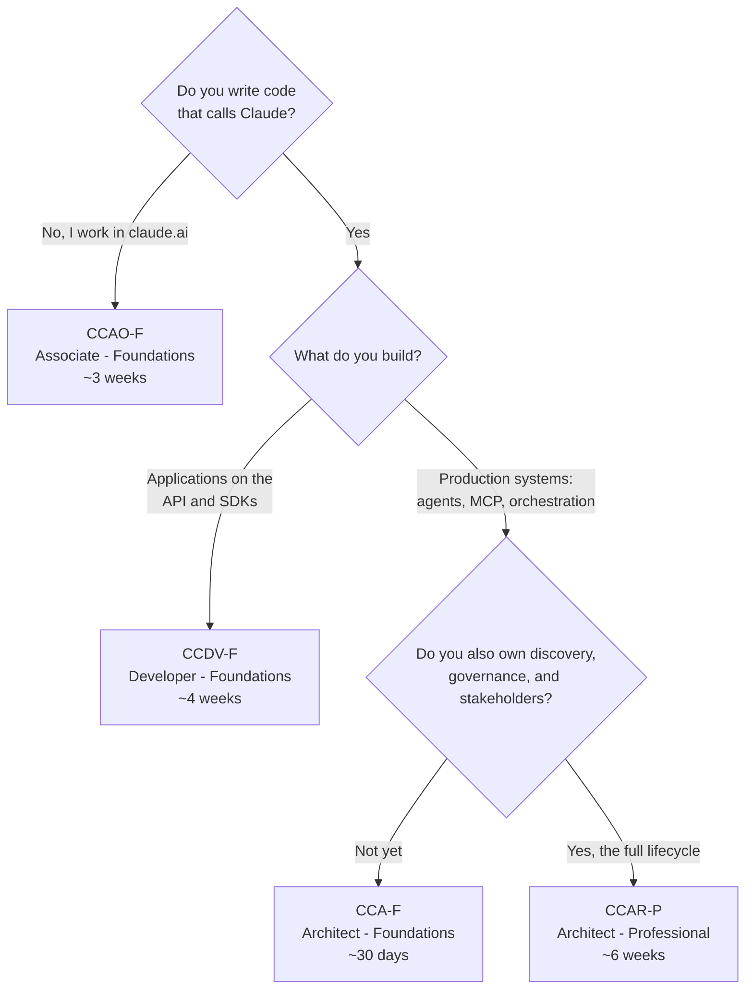
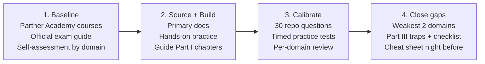
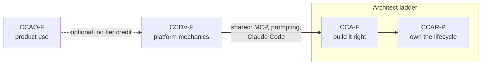

# Claude Certification Roadmap

A study roadmap built from the [preporato/claude-certification-guide](https://github.com/preporato/claude-certification-guide) repo (October 2026 edition). It turns the repo's four study guides, 120 practice questions and practice test into one plan: choose an exam, follow a phased schedule, hit the milestones, and walk in ready.

> The repo is not affiliated with Anthropic. Exam facts (prices, domains, policies) are as of October 2026; the Anthropic Partner Academy is the authority.

**Repo shortcuts**

A copy of the guide repo is cloned into [`claude-certification-guide/`](./claude-certification-guide/), and the guide and question links below open that copy. To refresh it, run `git -C claude-certification-guide pull`. The timed tests are hosted online. The same test also runs offline from [`docs/index.html`](./claude-certification-guide/docs/index.html).

| Exam | Guide | Practice questions | Timed test |
|---|---|---|---|
| CCAO-F | [guide.md](./claude-certification-guide/ccao-f/guide.md) | [30 Qs](./claude-certification-guide/ccao-f/practice-questions.md) | [test](https://preporato.github.io/claude-certification-guide/#ccao-f) |
| CCDV-F | [guide.md](./claude-certification-guide/ccdv-f/guide.md) | [30 Qs](./claude-certification-guide/ccdv-f/practice-questions.md) | [test](https://preporato.github.io/claude-certification-guide/#ccdv-f) |
| CCA-F | [guide.md](./claude-certification-guide/cca-f/guide.md) | [30 Qs](./claude-certification-guide/cca-f/practice-questions.md) | [test](https://preporato.github.io/claude-certification-guide/#cca-f) |
| CCAR-P | [guide.md](./claude-certification-guide/ccar-p/guide.md) | [30 Qs](./claude-certification-guide/ccar-p/practice-questions.md) | [test](https://preporato.github.io/claude-certification-guide/#ccar-p) |

PDF and EPUB versions of each guide, with the practice questions at the back, are in [`downloads/`](./claude-certification-guide/downloads).

---

## Contents

- [Phase 0: Check eligibility and pick a track](#phase-0-check-eligibility-and-pick-a-track)
- [The four exams at a glance](#the-four-exams-at-a-glance)
- [The common pattern](#the-common-pattern)
- [Roadmap A: CCAO-F (3 weeks)](#roadmap-a-ccao-f-associate--foundations-3-weeks)
- [Roadmap B: CCDV-F (4 weeks)](#roadmap-b-ccdv-f-developer--foundations-4-weeks)
- [Roadmap C: CCA-F (30 days)](#roadmap-c-cca-f-architect--foundations-30-days)
- [Roadmap D: CCAR-P (6 weeks)](#roadmap-d-ccar-p-architect--professional-6-weeks)
- [Multi-exam paths](#multi-exam-paths)
- [Exam day](#exam-day)
- [After the exam](#after-the-exam)

---

## Phase 0: Check eligibility and pick a track

**Step 1: confirm you can register.** Registration runs through the **Anthropic Partner Academy** and is open only to staff of **Claude Partner Network** organizations, using a company email on a domain in the partner record. Personal addresses don't work. If you're outside the network, the public **Anthropic Academy** courses teach the same material, but their certificates of completion are not certifications.

**Step 2: choose your exam.** There are no prerequisites and no required order.

**Step 3: budget and book.** Every attempt costs the full fee. Select, Preferred and Global Premier partners get 50% off, and Global Premier partners take every exam free through December 31, 2026. Booking a date now gives you a deadline; rescheduling is free up to 48 hours before the appointment.

---

## The four exams at a glance

| | CCAO-F | CCDV-F | CCA-F | CCAR-P |
|---|---|---|---|---|
| Audience | Business users of claude.ai | Engineers on the API and SDKs | Builders of production agent systems | Solution architects who own the full lifecycle |
| Price | $99 | $125 | $125 | $175 |
| Questions | 60 | 53 | 60 | 63 |
| Typical prep | ~3 weeks | ~4 weeks | ~30 days | ~6 weeks |
| Baseline assumed | Regular claude.ai use | 1-5 yrs engineering, 6+ mo LLM work | Hands-on agent building | 3+ yrs architecture, 6+ mo production LLM |
| Primary source | claude.ai Help Center | docs.anthropic.com | docs.anthropic.com | docs.anthropic.com |
| Counts for partner tier | No | Yes | Yes | Yes |

**Shared format for all four:** 120 minutes (about 135 minutes in the seat), Pearson VUE at a test center or online proctored, English or Japanese, scaled score 100-1000 with **720 to pass**, about a quarter of questions multiple-response ("Select TWO/THREE") with **no partial credit**.

---

## The common pattern

Every roadmap below uses the same four phases. Only the length and content change.

Each guide is laid out to match:

- **Part I**: technology or material chapters (read during phase 2)
- **Part II**: one note per exam domain (re-read during phase 4 for weak domains)
- **Part III**: preparation ladder, trap answers, exam-day strategy, worked questions, study plan, pre-exam checklist (phases 3 and 4)

**The preparation ladder** (from every guide):

| Step | Resource | Cost |
|---|---|---|
| 1. Learn the vocabulary | Partner Academy courses, official exam guide, Anthropic Academy courses | Free |
| 2. Go to the source | docs.anthropic.com, or the claude.ai Help Center for CCAO-F | Free |
| 3. First calibration | 30 repo questions and the browser practice test | Free |
| 4. Full calibration | Full-length timed practice tests (Preporato) | Paid |
| 5. Prove it hands-on | Auto-graded build projects (Preporato; not offered for CCAO-F) | Paid |

Steps 1-3 are free and enough to tell you where you stand.

---

## Roadmap A: CCAO-F Associate - Foundations (3 weeks)

**Who it's for:** operations, marketing, PM, education and communications staff who use claude.ai. No code, and API knowledge earns nothing here.

### Domain weights and where to study them

| Domain | Weight | Guide chapter |
|---|---|---|
| Output Evaluation and Validation | **21%** | Ch 1: Evaluating outputs and catching hallucinations |
| Workflow Integration and Solution Design | 16% | Ch 2: Fitting Claude into business workflows |
| Governance, Risk, and Responsible Use | 15% | Ch 3: Governance and responsible use |
| Prompting and Task Execution | 14% | Ch 4: Prompting for business tasks |
| Product and Model Selection | 12% | Ch 5: Choosing models and features |
| Configuration and Knowledge Management | 12% | Ch 6: Projects, knowledge, and connectors |
| Troubleshooting and Optimization | 10% | Ch 7: Troubleshooting weak outputs |

> The two judgment domains (evaluation and governance) make up **36%**. Don't prepare for it as a features quiz.

### Week 1: Baseline
- [ ] Confirm Partner Network eligibility and register on the Partner Academy
- [ ] Complete the Partner Academy associate courses
- [ ] Read the official exam guide and rate yourself 1-5 on each of the seven domains
- [ ] Read guide Ch 1-3 (evaluation, workflows, governance)
- **Milestone:** a written self-assessment by domain

### Week 2: Deliberate product practice
- [ ] Go through the claude.ai Help Center systematically
- [ ] Build a **Project** with custom instructions and uploaded knowledge
- [ ] Produce **Artifacts** for a real deliverable
- [ ] Run **research mode** on a real question
- [ ] Connect a live source with a **connector** (e.g. Google Drive or Gmail)
- [ ] Compare **Haiku, Sonnet and Opus** on the same task
- [ ] Run the validation sequence (Ch 1.2) on a real output
- [ ] Apply the governance do/don't matrix to your own team's data
- [ ] Read guide Ch 4-7
- **Milestone:** every blueprint feature used on real work at least once

### Week 3: Calibrate
- [ ] Take the [30 practice questions](./claude-certification-guide/ccao-f/practice-questions.md), or the [timed test](https://preporato.github.io/claude-certification-guide/#ccao-f)
- [ ] Take full-length timed practice tests and review every miss
- [ ] Re-read the Part II notes for your two weakest domains
- [ ] Final pass on evaluation and governance scenarios
- [ ] Memorize the **six trap answers**: Trust-the-output, Strongest-model-everywhere, One-giant-prompt, Paste-first, Regenerate-and-hope, Rebuild-every-session
- [ ] Night before: Part III and the cheat sheet
- **Milestone:** every item on the guide's pre-exam checklist is true

---

## Roadmap B: CCDV-F Developer - Foundations (4 weeks)

**Who it's for:** engineers building applications on the Claude API, the SDKs and the Agent SDK. Assumes Python or TypeScript, REST and the command line.

### Domain weights and where to study them

| Domain | Weight | Guide chapter |
|---|---|---|
| Applications and Integration | **33%** | Ch 1: Messages API · Ch 2: Streaming, caching, batch |
| Model Selection and Optimization | 17% | Ch 3: Model selection and cost |
| Agents and Workflows | 15% | Ch 4: Agents and workflows |
| Prompt and Context Engineering | 11% | Ch 5: Prompt and context engineering |
| Tools and MCPs | 10% | Ch 6: Tools, Skills, and MCP |
| Security and Safety | 8% | Ch 7: Security and safety |
| Claude Code | 3% | Ch 8.1: The component map |
| Eval, Testing, and Debugging | 3% | Ch 8.2: Failure isolation |

> At 53 questions this is the shortest exam, so each miss costs more. The small domains (security, Claude Code, evals) add up to about a seventh of the exam. Don't skip them.

### Week 1: Baseline
- [ ] Register and complete the Partner Academy developer courses
- [ ] Read the exam guide and self-assess against all eight domains
- [ ] Optional free courses: *Building with the Claude API*, *Introduction to MCP*, *Claude Code 101*
- [ ] Read guide Ch 1-3 (API, streaming/caching/batch, model selection)

### Weeks 2-3: Build against the API
Work with code open and docs.anthropic.com alongside. Build each of these:
- [ ] A Messages API client that checks `stop_reason` before parsing
- [ ] A **streaming** response
- [ ] **Prompt caching** with stable content first, verified through `cache_read_input_tokens`
- [ ] A **batch** job with results matched back by `custom_id`
- [ ] A **vision** input
- [ ] **Extended thinking** and effort levels compared on one task
- [ ] An **Agent SDK** loop with one hook
- [ ] One **MCP** integration
- [ ] A **structured-output** pipeline with defensive parsing
- [ ] Read guide Ch 4-8 alongside the builds
- **Milestone:** a working repo that exercises every item above

### Week 4: Calibrate
- [ ] [30 practice questions](./claude-certification-guide/ccdv-f/practice-questions.md) / [timed test](https://preporato.github.io/claude-certification-guide/#ccdv-f)
- [ ] Full-length timed practice tests and per-domain review
- [ ] Re-read Part II notes for weak domains
- [ ] Memorize the **nine trap answers**: Flagship-everywhere, Agent-by-default, Prompt-guarantee, Cache-the-volatile, Batch-for-interactive, Everything-through-MCP, More-tools, Shared-credential, Personal-config
- [ ] Order the cost levers, with a tier downgrade last
- [ ] Night before: trap table and the cheat sheet
- **Milestone:** pre-exam checklist complete

---

## Roadmap C: CCA-F Architect - Foundations (30 days)

**Who it's for:** people who build production Claude and agent systems end to end. This is the most Claude-Code-heavy exam in the program.

### Domain weights and where to study them

| Domain | Weight | Guide chapter |
|---|---|---|
| Agentic Architecture & Orchestration | **27%** | Ch 1: API and the agentic loop · Ch 3: Multi-agent orchestration |
| Claude Code | 20% | Ch 5: Claude Code |
| Prompt Engineering & Structured Output | 20% | Ch 6: Prompt engineering and structured output |
| Tool Design & MCP | 18% | Ch 2: Tools and tool_use · Ch 4: MCP |
| Context Management & Reliability | 15% | Ch 7: Context management · Ch 8: Reliability and recovery |

### The scenario format
The question pool is built around **six production scenarios, and each sitting draws four**. Learn all six before exam day:

1. Automated Code Review Pipeline
2. Customer Support Escalation System
3. Document Extraction at Scale
4. Multi-Repository Security Audit
5. Knowledge Base Q&A System
6. CI/CD Compliance Enforcement

### Days 1-7: Baseline
- [ ] Register and complete the Partner Academy architect courses
- [ ] Read the official exam guide and map your experience against the five domains
- [ ] Free courses mapped to domains: *Claude Code 101* / *in Action* (Claude Code), *Intro to MCP* / *MCP Advanced* (tools), *Intro to subagents* / *agent skills* (orchestration), *Building with the Claude API* (foundation)
- [ ] Read the guide's "six production scenarios" section and Ch 1-2

### Days 8-21: Build
Use guide Part I as the reading companion while you build:
- [ ] An agent with tools and a real loop that ends on `stop_reason`, not prose parsing or iteration caps (Ch 1)
- [ ] 4-5 scoped tools with structured, retryability-classified errors (Ch 2)
- [ ] A hub-and-spoke coordinator with parallel and sequential subagents (Ch 3)
- [ ] An **MCP server** exposing tools, resources and prompts, configured through `.mcp.json` with `${ENV_VAR}` secrets (Ch 4)
- [ ] A **Claude Code** setup: CLAUDE.md hierarchy, a path-scoped rule, one **skill**, one **hook**, and a headless CI run (`-p`, `--output-format json`) (Ch 5)
- [ ] A structured extraction with nullable and `"unclear"` fields, a validation-retry loop, and a Batch API run (Ch 6)
- [ ] Context-degradation mitigation with scratchpads and compaction, plus manifest-based crash recovery (Ch 7-8)
- **Milestone:** you have run into each failure mode yourself at least once

### Days 22-30: Calibrate
- [ ] [30 practice questions](./claude-certification-guide/cca-f/practice-questions.md) / [timed test](https://preporato.github.io/claude-certification-guide/#cca-f)
- [ ] At least two full-length, timed, scenario-format practice tests
- [ ] Re-read Part II for your two weakest domains
- [ ] Learn the **Golden Rule**: programmatic enforcement beats prompt-based guidance
- [ ] Learn the **five mental models**: Determinism, Isolation, Recovery, Attention Budget, Calibration
- [ ] Learn the **seven anti-patterns** and the **critical distinctions** table (e.g. `tool_choice: any` vs `auto`, `--resume` vs `fork_session`, hooks vs CLAUDE.md)
- [ ] Night before: Part III tables and the cheat sheet
- **Milestone:** all 26 lines of the pre-exam checklist are true

---

## Roadmap D: CCAR-P Architect - Professional (6 weeks)

**Who it's for:** the architect accountable for a Claude solution's whole life, from discovery to governance to stakeholder sign-off. It is not a harder CCA-F. Most questions sit above the code.

### Domain weights and where to study them

| Domain | Weight | Guide chapter |
|---|---|---|
| Integration | **19%** | Ch 3: Integration mechanisms · Ch 4: RAG and retrieval |
| Solution Design & Architecture | 17% | Ch 1: Architecture patterns and solution design |
| Evaluation, Testing & Optimization | 16% | Ch 5: Evaluation, testing, and optimization |
| Governance, Safety & Risk | 14% | Ch 6: Governance, safety, and compliance |
| Stakeholder Communication & Lifecycle | 14% | Ch 7: Stakeholders and the solution lifecycle |
| Models, Prompting & Context Engineering | 13% | Ch 2: Models, prompting, and caching |
| Developer Productivity & Enablement | 7% | Ch 8: Team enablement |

> Stakeholder work is where technically strong candidates lose the most points. It's about nine questions on discovery, expectation setting, ADRs and SLAs.

### Weeks 1-2: Baseline and gap map
- [ ] Register and complete the Partner Academy architect courses
- [ ] Read the official exam guide
- [ ] Map your experience against all seven domains. Most people's gap is governance or stakeholder work.
- [ ] Optional: take CCA-F first for the vocabulary (see [Multi-exam paths](#multi-exam-paths))
- [ ] Read guide Ch 1-2 (patterns, model tiers, prompt caching)

### Weeks 3-4: The enterprise domains
- [ ] Integration: choose between MCP, direct API and agent-to-agent; spot capability bloat; use per-user authorization (Ch 3)
- [ ] RAG: chunking trade-offs, when re-ranking is needed, fixing retrieval before adding more context (Ch 4)
- [ ] Evaluation: match metrics to failure modes, build a held-out eval set shaped like production, divide work between grader, judge and human, run A/B tests (Ch 5)
- [ ] Governance: the five guardrail layers, HITL placement, and GDPR, HIPAA and FedRAMP matched to scenarios (Ch 6)
- [ ] **Run a mock engagement end to end:** discovery outputs, an SLA with an error budget, and an **ADR** (Ch 7)
- [ ] Team enablement and version-controlled standards (Ch 8)
- **Milestone:** a written ADR and discovery document for a hypothetical project

### Weeks 5-6: Calibrate
- [ ] [30 practice questions](./claude-certification-guide/ccar-p/practice-questions.md) / [timed test](https://preporato.github.io/claude-certification-guide/#ccar-p)
- [ ] Full-length timed 63-question practice tests. Read the per-domain breakdown closely, because with seven domains a good average can hide a failing one.
- [ ] Drill your weakest two domains
- [ ] Memorize the **nine trap answers**: Flagship-everywhere, Agentic-by-default, Prompt-guarantee, Context-stuffing, Mega-agent, Skip-discovery, All-or-nothing HITL, Aggregate-metric, Single-framework
- [ ] Final week: Part III every day; cheat sheet the night before
- **Milestone:** pre-exam checklist complete

---

## Multi-exam paths

Stacking works best when the exams certify different parts of one job.

| Path | Suggested schedule | Why |
|---|---|---|
| **CCA-F → CCAR-P** (the architect ladder) | Weeks 1-4 CCA-F, sit the exam, then weeks 5-10 CCAR-P | The deliberate two-tier path. CCA-F gives you the vocabulary CCAR-P assumes. |
| **CCDV-F → CCA-F** (builder) | Weeks 1-4 CCDV-F, then about 3 weeks CCA-F | Shared MCP, prompting and Claude Code material makes the second exam cheaper to study for. Add more Claude Code depth (20% vs 3%). |
| **Full engineering track** | CCDV-F → CCA-F → CCAR-P over about 4 months | Covers all three partner-tier credentials. |
| **Direct to CCAR-P** | 6+ weeks | For experienced architects. Most still benefit from CCA-F first. |

Space exams out so you can plan around retakes. Renewal deadlines then also come at different times.

---

## Exam day

| Exam | Pace | Tactic |
|---|---|---|
| CCAO-F | 2:00 per question, short stems | Time pressure is mild. If a scenario involves facts, people or sensitive data, expect the right answer to include a safeguard. |
| CCDV-F | ~2:15 per question | The risk is carelessness. Identify the exact mechanic being tested (stop_reason? cache prefix? batch fit?). |
| CCA-F | 2:00 per question, long scenarios | Spend about 10 minutes reading the scenario intros, then cap each scenario at about 20 minutes. Use the last 10 minutes for flagged questions. |
| CCAR-P | Just under 2:00 per question, long stems | Read the question line first, then the scenario. Find the named business constraint (cost, latency, compliance, reuse). |

**Universal rules**
- Before reading the options, identify the domain being tested.
- For multiple-response questions, check every option against the trap list on its own. One bad pick loses the whole question.
- Flag anything taking more than 3 minutes and come back at the end.
- Change an answer only when you're sure it's wrong.

---

## After the exam

**If you passed**
- [ ] Claim your **Credly badge** (valid for 12 months)
- [ ] **Set a renewal reminder for month 10.** Renewal before expiry is a free, open-book online assessment that adds 12 months. If the credential lapses, you have to sit a full-price proctored exam.
- [ ] Optional: add yourself to [PASSED.md](https://github.com/preporato/claude-certification-guide/blob/main/PASSED.md), without any exam question content
- [ ] Plan your next exam from [Multi-exam paths](#multi-exam-paths)

**If you didn't pass**
- [ ] Use the percent-correct-by-domain breakdown on your score report to choose what to study
- [ ] Waiting periods: **14 days** after the 1st failure, **30** after the 2nd, **90** after the 3rd. Maximum **4 attempts in 12 months**.
- [ ] Every retake costs the full fee, so don't rebook on impulse. Re-run phases 3-4 of your roadmap first.

---

## Progress tracker

| Milestone | CCAO-F | CCDV-F | CCA-F | CCAR-P |
|---|---|---|---|---|
| Eligibility confirmed | ☐ | ☐ | ☐ | ☐ |
| Partner Academy courses done | ☐ | ☐ | ☐ | ☐ |
| Domain self-assessment written | ☐ | ☐ | ☐ | ☐ |
| Guide Part I read | ☐ | ☐ | ☐ | ☐ |
| Hands-on work complete | ☐ | ☐ | ☐ | ☐ |
| 30 repo questions taken | ☐ | ☐ | ☐ | ☐ |
| 2+ full timed practice tests | ☐ | ☐ | ☐ | ☐ |
| Trap answers memorized | ☐ | ☐ | ☐ | ☐ |
| Pre-exam checklist all true | ☐ | ☐ | ☐ | ☐ |
| Exam booked | ☐ | ☐ | ☐ | ☐ |
| Passed | ☐ | ☐ | ☐ | ☐ |
| Renewal reminder set (month 10) | ☐ | ☐ | ☐ | ☐ |

---

*Source: [github.com/preporato/claude-certification-guide](https://github.com/preporato/claude-certification-guide) (MIT). Roadmap compiled 2026-10-21.*
